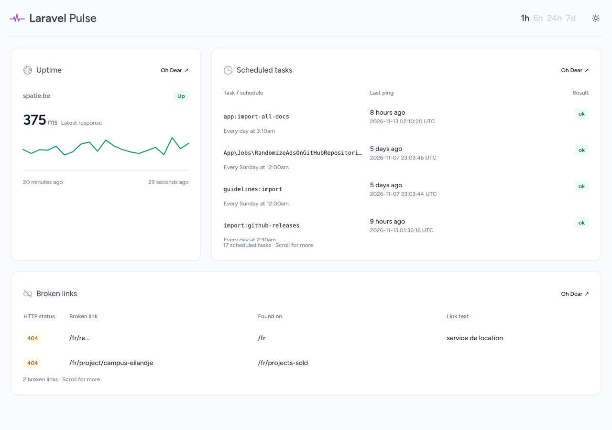
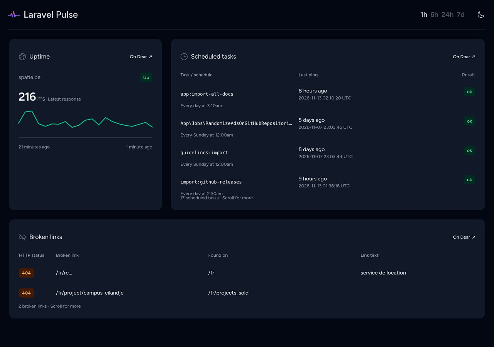

# Integrate Oh Dear with Laravel Pulse

[](https://packagist.org/packages/ohdearapp/ohdear-pulse)
[](https://github.com/ohdearapp/ohdear-pulse/actions?query=workflow%3Arun-tests+branch%3Amain)
[](https://github.com/ohdearapp/ohdear-pulse/actions?query=workflow%3A"Fix+PHP+code+style+issues"+branch%3Amain)
[](https://packagist.org/packages/ohdearapp/ohdear-pulse)

This package contains Pulse cards that show results from [Oh Dear](https://ohdear.app) in your [Laravel Pulse](https://pulse.laravel.com) dashboard.

Version 2 requires PHP 8.3 or newer, Laravel 13, and Laravel Pulse 1.10 or newer. It uses the current Oh Dear monitor API through the official PHP SDK 4.7 or newer. See [UPGRADING](UPGRADING.md) when coming from v1.

There are three cards available:

- [Uptime and Performance](https://ohdear.app/docs/features/uptime-monitoring)
- [Cron Job Monitoring](https://ohdear.app/docs/features/cron-job-monitoring)
- [Broken links](https://ohdear.app/docs/features/broken-links-detection)

These screenshots show all three cards with real Oh Dear API data:




## Installation

You can install the package via composer:

```bash
composer require ohdearapp/ohdear-pulse:^2.0
```

In your `config/services.php` file, add the following lines:

```php
'oh_dear' => [
    'pulse' => [
        'api_key' => env('OH_DEAR_API_TOKEN'),
        'monitor_id' => env('OH_DEAR_MONITOR_ID'),
    ],
],
```

Create an API token on the "API Tokens" page at Oh Dear. Use the monitor ID from your monitor's settings or its `/monitors/{id}` URL. Add `OH_DEAR_API_TOKEN` and `OH_DEAR_MONITOR_ID` to your application's environment. Never commit the token.

You can execute this artisan command to verify if you set up the configuration correctly.

```bash
php artisan ohdear-pulse:verify
```

## Usage

There are currently three cards available:

- `ohdear.pulse.uptime`: displays the uptime and performance of a site
- `ohdear.pulse.cron`: displays the results of the cron job monitoring
- `ohdear.pulse.brokenLinks`: displays any broken links that were detected

You can add the cards to your Pulse dashboard, by first publishing the Pulse's dashboard view:

```bash
php artisan vendor:publish --tag=pulse-dashboard
```

Next, add the cards to the `resources/views/vendor/pulse/dashboard.blade.php` file:

```html
<x-pulse>
    <livewire:ohdear.pulse.uptime cols="4" />
    
    <livewire:ohdear.pulse.cron cols="8" />

    <livewire:ohdear.pulse.brokenLinks cols="8" />
    
    {{-- Add more cards here --}}
</x-pulse>
```

All cards accept an optional `:monitor-id="123"` attribute. Without it, they use `services.oh_dear.pulse.monitor_id`. Keep your application's Pulse authorization gate in place; these cards display monitoring data to anyone who can view the dashboard.

The uptime card shows the latest measured HTTP response and a chronological, 20-minute sparkline. Empty API buckets are not measurements. Non-HTTP monitors show their uptime status without an HTTP chart. Scheduled tasks and broken links include every page of API results in keyboard-scrollable tables.

Uptime data is cached for 30 seconds, scheduled tasks for one minute, and broken links for 15 minutes. Cache entries are scoped to the API token and monitor. The cards poll automatically and display recovery instructions if Oh Dear cannot be reached. Assets ship with the package; consumers do not need Node or a Tailwind build.

## Testing

Running the test suite requires PHP 8.4 or newer for Pest 5. The package's runtime requirement remains PHP 8.3 or newer.

```bash
composer test
composer analyse
vendor/bin/pint --test
npm ci && npm run build
```

### Local Pulse dashboard

The repository includes a Workbench dashboard using real API data:

```bash
composer install
composer build
vendor/bin/testbench key:generate
```

Add `OH_DEAR_API_TOKEN` and `OH_DEAR_MONITOR_ID` to the generated `vendor/orchestra/testbench-core/laravel/.env`, then run `composer start`. Optionally set `OH_DEAR_BROKEN_LINKS_MONITOR_ID` to show broken links from a different monitor. Open `/pulse` on the development server. The Workbench dashboard is local-only and does not replace your production Pulse authorization.

## Changelog

Please see [CHANGELOG](CHANGELOG.md) for more information on what has changed recently.

## Contributing

Please see [CONTRIBUTING](CONTRIBUTING.md) for details.

## Security Vulnerabilities

Please review [our security policy](../../security/policy) on how to report security vulnerabilities.

## Credits

- [Freek Van der Herten](https://github.com/freekmurze)
- [Laravel Shift](https://github.com/laravel-shift), for the Laravel 13 compatibility work in [#23](https://github.com/ohdearapp/ohdear-pulse/pull/23)
- [Dependabot](https://github.com/dependabot), for the workflow updates in [#19](https://github.com/ohdearapp/ohdear-pulse/pull/19), [#25](https://github.com/ohdearapp/ohdear-pulse/pull/25), and [#26](https://github.com/ohdearapp/ohdear-pulse/pull/26)
- [All Contributors](../../contributors)

## License

The MIT License (MIT). Please see [License File](LICENSE.md) for more information.
