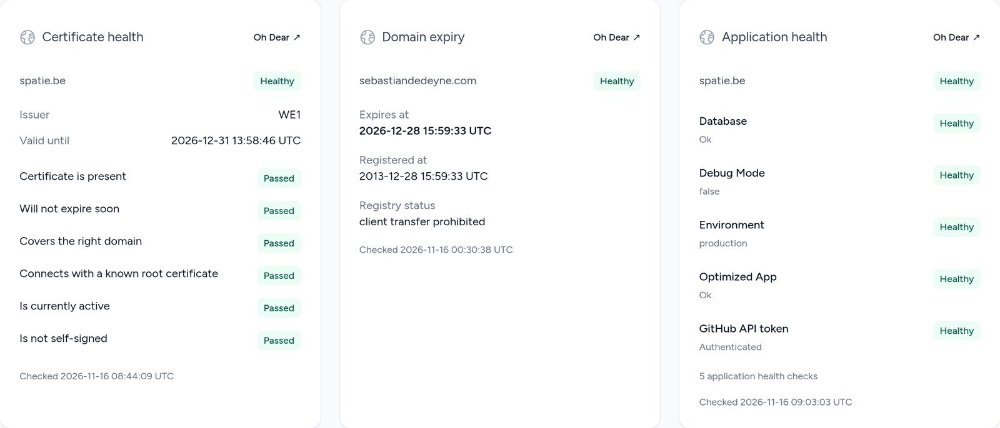
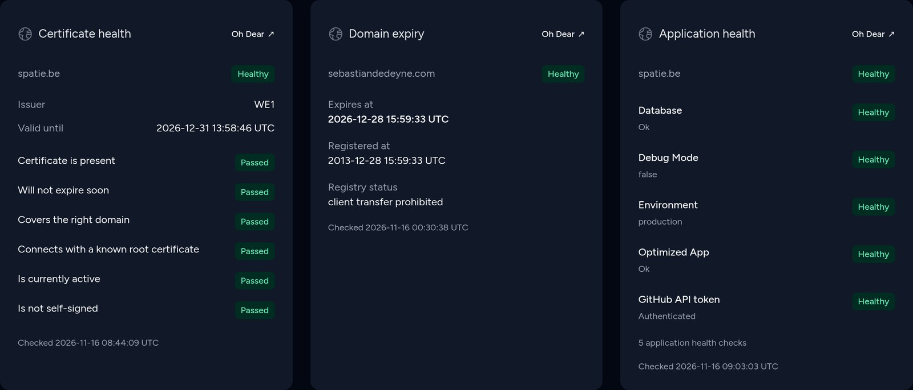

# Pulse card guide

Version 2.1 includes six cards. All use the API token and default monitor in `services.oh_dear.pulse`. Follow the [installation instructions](../README.md#installation) first, then add the cards to `resources/views/vendor/pulse/dashboard.blade.php`.

## Certificate health

```blade
<livewire:ohdear.pulse.certificateHealth cols="4" />
```

Shows the certificate issuer, validity date and individual pass/fail checks. The overall status comes from Oh Dear's certificate health check. Enable certificate health monitoring for the monitor in Oh Dear. Certificate checks are keyboard-scrollable when the list exceeds the card height.

## Domain expiry

```blade
<livewire:ohdear.pulse.domain cols="4" />
```

Shows the registry's expiry date, registration date and active registry statuses. Dates are displayed in UTC. Only enabled registry flags are listed.

Some registries do not provide an expiry date or do not support this check. A missing date reads "Not provided by registry". Unsupported checks stay neutral. Oh Dear determines warning and failure severity; the card does not apply a separate renewal threshold.

## Application health

```blade
<livewire:ohdear.pulse.applicationHealth cols="4" />
```

Shows each application health check's label, status, short summary and message. Configure application health reporting for your monitor in Oh Dear, for example with [Laravel Health](https://spatie.be/docs/laravel-health).

Warning, failed and crashed checks raise the card's overall severity. Snoozed checks do not raise it. Skipped, pending and snoozed results have neutral labels. The list is keyboard-scrollable. Raw metadata is not sent to the browser; displayed summaries and messages are escaped.

## Result states

The three cards above show the latest Oh Dear results. Pulse's selected time range does not change those results.

| State | What the card shows |
| --- | --- |
| Healthy | Available check results with no reported warning or failure. |
| Warning or failing | Oh Dear's status and summary, plus the available detail results. Application checks can raise the overall severity. |
| Empty report | A neutral "No results" badge and an explanation of which details are missing. |
| Disabled, snoozed, pending or unavailable | A neutral status and explanation. Stale detail results are not fetched. |
| Unconfigured | Instructions to set the API token and monitor ID. |
| API error | A contained authorization, monitor-access, rate-limit or connection message. The card retries on its next refresh. |
| Loading | A placeholder until Livewire loads the card. |

If every card remains at Loading, check the browser's Livewire requests. When serving Pulse behind an HTTPS reverse proxy, configure Laravel's trusted proxies so generated update URLs also use HTTPS. This is application configuration, not an Oh Dear API failure.

## Existing cards

```blade
<livewire:ohdear.pulse.uptime cols="4" />
<livewire:ohdear.pulse.cron cols="8" />
<livewire:ohdear.pulse.brokenLinks cols="full" />
```

The uptime card shows current uptime and a 20-minute HTTP response-time chart. Non-HTTP monitors show status without the HTTP chart. Scheduled tasks and broken links include all pages of results in scrollable tables.

## Monitor overrides and refresh intervals

Every card accepts a numeric monitor override:

```blade
<livewire:ohdear.pulse.domain cols="4" :monitor-id="123" />
```

The token must have access to that monitor. Keep your application's Pulse authorization gate enabled; the cards show monitoring data to dashboard viewers.

Shared monitor and uptime data are cached for 30 seconds. Certificate, domain and application-health details are cached for one minute, as are scheduled tasks. Broken links are cached for 15 minutes. Cache keys include the token and monitor. The three new cards poll every minute. Assets ship with the package; no Node or Tailwind build is required in the consuming application.

## Screenshots

These show real read-only API results. The domain card uses a different monitor because not every domain registry provides expiry data.




For controlled empty, warning, failing and error examples, run the repository's [local Workbench dashboard](../README.md#local-pulse-dashboard). Its labelled HTTP fixtures do not change production monitors and are excluded from the package distribution.
